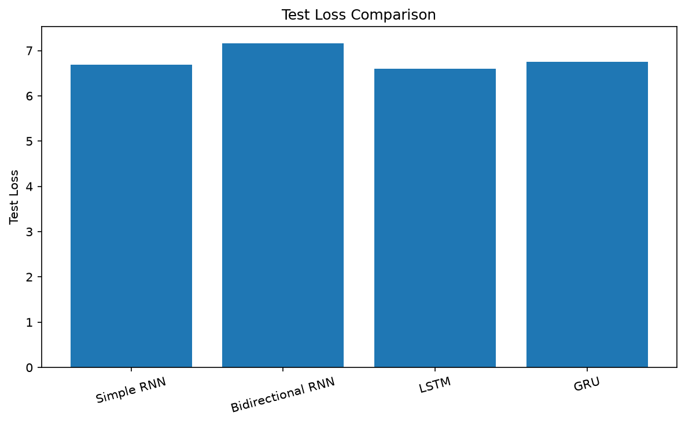
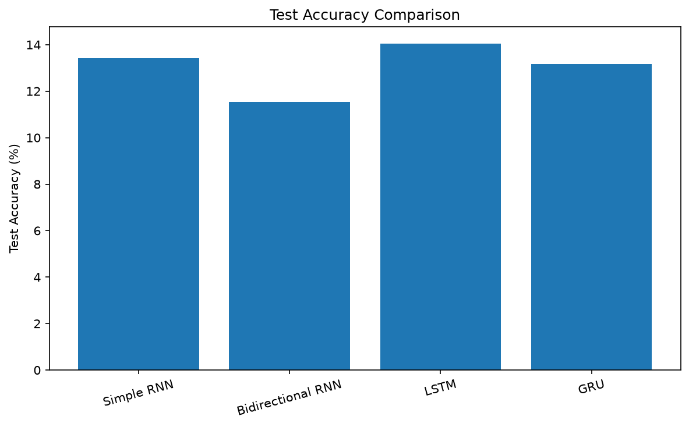
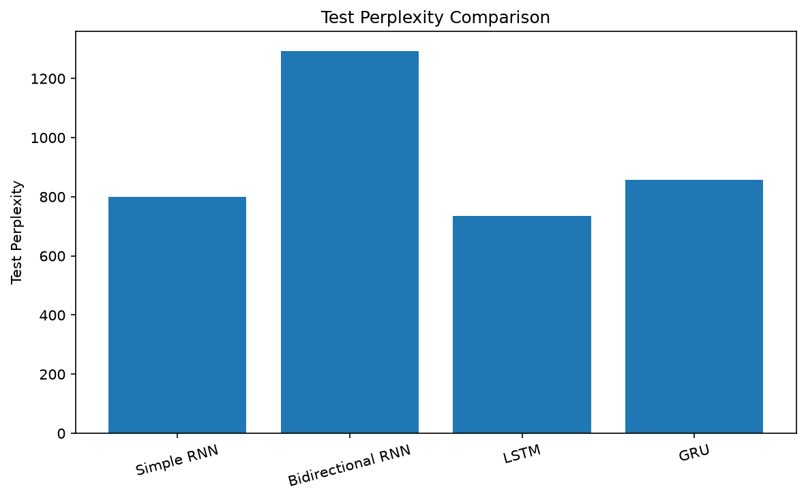
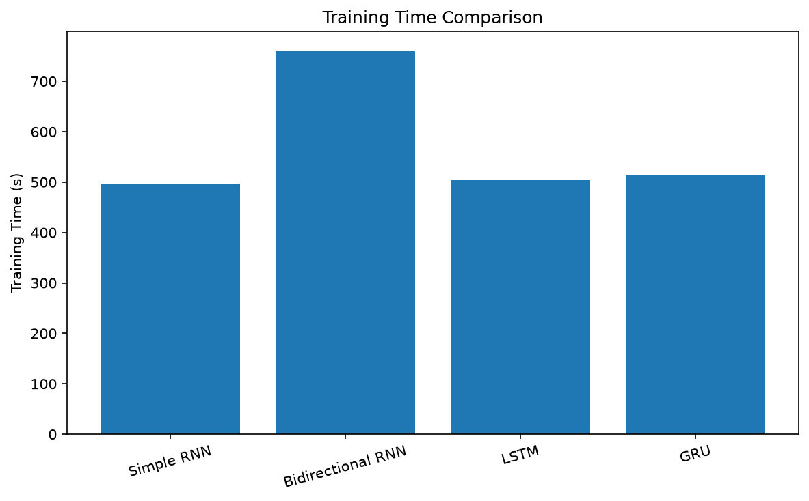

# Text Generation Using Recurrent Neural Networks (RNNs)

[](https://www.python.org/)
[](https://pytorch.org/)
[](https://jupyter.org/)
[](https://github.com/karpathy/char-rnn/blob/master/data/tinyshakespeare/input.txt)
[]()

An empirical study and benchmark of recurrent neural network architectures for **next-token prediction** and **autoregressive text generation**, trained on the works of William Shakespeare.

---

## Table of Contents

- [1. Problem Statement and Objectives](#1-problem-statement-and-objectives)
- [2. Dataset & Preprocessing Pipeline](#2-dataset--preprocessing-pipeline)
- [3. Evaluated Architectures](#3-evaluated-architectures)
- [4. Methodology](#4-methodology)
- [5. Empirical Benchmark & Comparison](#5-empirical-benchmark--comparison)
  - [Quantitative Metrics](#quantitative-metrics)
  - [Visual Comparison](#visual-comparison)
  - [Analytical Interpretation](#analytical-interpretation)
- [6. Text Generation & Sampling Temperature Analysis](#6-text-generation--sampling-temperature-analysis)
  - [Sampling Dynamics](#sampling-dynamics)
  - [Diversity & Repetition Statistics](#diversity--repetition-statistics)
  - [Qualitative Generation Samples](#qualitative-generation-samples)
- [7. Repository Structure](#7-repository-structure)
- [8. Getting Started](#8-getting-started)
  - [Prerequisites](#prerequisites)
  - [Installation & Execution](#installation--execution)
- [9. Conclusion & Key Takeaways](#9-conclusion--key-takeaways)

---

## 1. Problem Statement and Objectives

The objective of this assignment is to design, train, and comprehensively evaluate four foundational Recurrent Neural Network (RNN) architectures for character/word sequential modeling:

1. **Simple Recurrent Neural Network (Simple RNN)**
2. **Bidirectional Recurrent Neural Network (BiRNN)**
3. **Long Short-Term Memory (LSTM)**
4. **Gated Recurrent Unit (GRU)**

The models learn sequential syntactic and semantic structures from Shakespearean literature to predict subsequent tokens and generate stylistically consistent literary passages from arbitrary seed prompts.

---

## 2. Dataset & Preprocessing Pipeline

- **Dataset:** Tiny Shakespeare ([Download / Reference Source](https://github.com/karpathy/char-rnn/blob/master/data/tinyshakespeare/input.txt))
- **Content:** 40,000 lines from multiple Shakespearean plays, encompassing dramatic dialogue, poetry, and character annotations.

### Preprocessing Specifications

| Parameter | Specification |
|:---|:---|
| **Tokenization Strategy** | Word-level tokenization with preserved punctuation |
| **Total Processed Tokens** | 262,927 tokens |
| **Vocabulary Size ($V$)** | 11,786 unique tokens |
| **Special Tokens** | `<UNK>` (Out-of-vocabulary), `<PAD>` (Sequence padding) |
| **Split Ratio** | 80% Training / 10% Validation / 10% Test |

---

## 3. Evaluated Architectures

| Architecture | Structural Mechanism | Primary Strengths & Limitations |
|:---|:---|:---|
| **Simple RNN** | Single recurrent hidden state vector updated via $h_t = \tanh(W x_t + U h_{t-1} + b)$. | Computationally lightweight and fast, but suffers from vanishing and exploding gradients over long horizons. |
| **Bidirectional RNN** | Dual recurrent layers processing the input sequence simultaneously forward ($\overrightarrow{h}_t$) and backward ($\overleftarrow{h}_t$). | Excellent for sequence tagging/classification; however, backwards dependency causes exposure discrepancy during causal, autoregressive generation. |
| **LSTM** | Gated memory cell ($c_t$) regulated by three non-linear gates: *input* ($i_t$), *forget* ($f_t$), and *output* ($o_t$). | Mitigates vanishing gradients and retains long-term grammatical context, but introduces higher parameter count. |
| **GRU** | Streamlined gating mechanism combining cell state and hidden state, governed by *reset* ($r_t$) and *update* ($z_t$) gates. | Faster training and fewer parameters than standard LSTM while retaining robust resistance to vanishing gradients. |

---

## 4. Methodology

The end-to-end experimental workflow follows standard machine learning engineering best practices:

```
[Raw Dataset] ──> [Tokenization & Vocab Building] ──> [Sequence Chunking (80/10/10)]
                                                              │
                                                              ▼
[Text Generation & Sampling] <── [Metric Evaluation] <── [Model Training & Checkpointing]
```

1. **Data Ingestion:** Load and sanitize raw text from `data/tinyshakespeare_raw.txt`.
2. **Vocabulary Construction:** Map frequent words to discrete integer IDs; map rare/unseen words to `<UNK>`.
3. **Sequence Preparation:** Construct input-target sliding windows for next-token prediction across training, validation, and test splits.
4. **Model Training:** Train Simple RNN, Bidirectional RNN, LSTM, and GRU under standardized optimization criteria and loss functions.
5. **Quantitative Benchmark:** Measure test cross-entropy loss, prediction accuracy, perplexity, and elapsed training duration.
6. **Controllable Text Generation:** Autoregressively sample continuation tokens from a fixed prompt (`"To be or not to be"`) under varying temperatures ($T \in \{0.5, 0.8, 1.2\}$).
7. **Artifact Archival:** Persist trained model checkpoints (`.pt`), metrics CSVs, training curves, and generated transcripts.

---

## 5. Empirical Benchmark & Comparison

### Quantitative Metrics

All models were evaluated on the held-out test split under identical testing conditions:

| Model Architecture | Test Loss $\downarrow$ | Test Accuracy (%) $\uparrow$ | Test Perplexity $\downarrow$ | Training Time (s) $\downarrow$ |
|:---|:---:|:---:|:---:|:---:|
| **Simple RNN** | 6.6830 | 13.42% | 798.73 | **496.82 s** |
| **Bidirectional RNN** | 7.1653 | 11.54% | 1293.72 | 760.23 s |
| **LSTM** | **6.5996** | **14.06%** | **734.81** | 503.17 s |
| **GRU** | 6.7546 | 13.17% | 857.97 | 514.44 s |

---

### Visual Comparison

<p align="center">
  
  
</p>
<p align="center">
  
  
</p>

---

### Analytical Interpretation

- **LSTM Champion Performance:** The LSTM model demonstrated the superior ability to model long-range Shakespearean syntax, achieving the lowest test loss (**6.5996**), lowest test perplexity (**734.81**), and highest test accuracy (**14.06%**).
- **Computational Efficiency:** The Simple RNN recorded the fastest training duration (**496.82 s**), closely followed by LSTM (**503.17 s**) and GRU (**514.44 s**).
- **BiRNN Autoregressive Limitation:** While Bidirectional RNNs excel at sequence encoding (where the full future context is known), they perform least favorably in strictly causal next-token generation (**1293.72 perplexity**, **760.23 s** training time) because future tokens are unobserved during step-by-step inference.

---

## 6. Text Generation & Sampling Temperature Analysis

### Sampling Dynamics

Text was generated autoregressively using the canonical Shakespearean prompt:  
`"To be or not to be"`

Next-token logits were modulated using temperature scaling before applying the softmax operator:
$$P(w_i) = \frac{\exp(z_i / T)}{\sum_j \exp(z_j / T)}$$

- **Low Temperature ($T = 0.5$):** Sharpens probability distribution toward high-confidence tokens. Produces grammatically structured and predictable text, with increased risk of local repetitive loops.
- **Moderate Temperature ($T = 0.8$):** Provides a balanced trade-off between structural coherence and stylistic vocabulary variety.
- **High Temperature ($T = 1.2$):** Flattens the probability distribution, encouraging novel, diverse vocabulary selection at the expense of syntactic consistency.

---

### Diversity & Repetition Statistics

| Model | Temperature ($T$) | Word Count | Unique Words | Distinct-1 (%) $\uparrow$ | Repeated Word Rate (%) $\downarrow$ |
|:---|:---:|:---:|:---:|:---:|:---:|
| **Simple RNN** | 0.5 | 50 | 39 | 78.00% | 22.00% |
| **Simple RNN** | 0.8 | 55 | 46 | 83.64% | 16.36% |
| **Simple RNN** | 1.2 | 56 | 46 | 82.14% | 17.86% |
| **Bidirectional RNN** | 0.5 | 50 | 41 | 82.00% | 18.00% |
| **Bidirectional RNN** | 0.8 | 52 | 39 | 75.00% | 25.00% |
| **Bidirectional RNN** | 1.2 | 50 | 41 | 82.00% | 18.00% |
| **LSTM** | 0.5 | 53 | 34 | 64.15% | 35.85% |
| **LSTM** | 0.8 | 54 | 42 | 77.78% | 22.22% |
| **LSTM** | 1.2 | 53 | 46 | **86.79%** | **13.21%** |
| **GRU** | 0.5 | 53 | 27 | 50.94% | 49.06% |
| **GRU** | 0.8 | 54 | 42 | 77.78% | 22.22% |
| **GRU** | 1.2 | 57 | 51 | **89.47%** | **10.53%** |

---

### Qualitative Generation Samples

> **Seed Prompt:** `"To be or not to be"`

| Model | $T$ | Sample Output Excerpt |
|:---|:---:|:---|
| **LSTM** | **0.5** | *"...found? Servant: I know you, sir, that you were a king, and the end of my son, my lord, and I must confess to the end. I ' ll be the more Than my son - - law, And I am ready to the crown, And therein fasting in his"* |
| **LSTM** | **0.8** | *"...hatch ' d? MISTRESS OVERDONE: I know You have made some thing to purpose. First Citizen: Why, what way means, his oath be released they tender: What think I can cut excused down, that blows to be ask ' d your hate, I am galled, of I send to London"* |
| **LSTM** | **1.2** | *"...clear remedy. Being your true comfort reign is falsehood, traitor, and look, makes them up to my exercises. Well Camillo, That young heir is cut death, verge the duke! Capel: Kindly me to deceived it, I let him come To Elbow have committed to cry. VOLUMNIA: Norfolk,"* |
| **GRU** | **0.5** | *"...obstinate. KING RICHARD II: Why, I am my uncle? DUCHESS OF YORK: I am king, I am king; For I am I love to myself myself, and I am myself: God were I open, and love myself, And therefore that I am in myself: therefore, I will"* |
| **Simple RNN** | **0.5** | *"...quiet, And yet I am going to the ground or mine eyes, And in thy soul - govern, and Saint George, Clifford, and his lover, kill ' d; and will be left. KING LEWIS XI: Why, how we were subjects? GLOUCESTER: A fellow, sir, I am"* |

---

## 7. Repository Structure

```text
├── Fgai_assignment.ipynb                    # Primary Jupyter notebook containing full pipeline
├── README.md                                # Project documentation, benchmark, and report
├── .gitignore                               # Git ignore configuration
│
├── models/                                  # Pre-trained PyTorch model checkpoint binaries
│   ├── simple_rnn.pt                        # Simple RNN trained weights (~17.9 MB)
│   ├── bidirectional_rnn.pt                 # Bidirectional RNN trained weights (~29.6 MB)
│   ├── lstm_model.pt                        # LSTM trained weights (~19.0 MB)
│   └── gru_model.pt                         # GRU trained weights (~18.7 MB)
│
└── data/                                    # Raw and processed datasets & experimental outputs
    ├── tinyshakespeare_raw.txt              # Raw Tiny Shakespeare corpus (~1.1 MB)
    └── processed/                           # Tokenized data, metadata, metrics, and plots
        ├── metadata.json                    # Dataset token counts, vocabulary size, split ratios
        ├── vocabulary.json                  # Word-to-index mapping dictionary
        ├── cleaned_text.txt                 # Preprocessed sanitized text
        ├── train_ids.npy / train_tokens.json
        ├── validation_ids.npy / validation_tokens.json
        ├── test_ids.npy / test_tokens.json
        ├── model_comparison.csv             # Quantitative performance comparison table
        ├── generation_statistics.csv        # Distinct-1, repetition rates, word counts
        ├── text_generation_results.csv      # Complete generated transcripts by model & temperature
        ├── simple_rnn_history.csv           # Epoch-wise training loss/accuracy logs
        ├── bidirectional_rnn_history.csv
        ├── lstm_history.csv
        ├── gru_history.csv
        ├── test_loss.png                    # Benchmark plot: Test Loss
        ├── test_accuracy.png                # Benchmark plot: Test Accuracy
        ├── test_perplexity.png              # Benchmark plot: Perplexity
        └── training_time.png                # Benchmark plot: Training Duration
```

---

## 8. Getting Started

### Prerequisites

- **Python:** 3.10 or 3.11 recommended
- **Hardware:** CPU or CUDA-compatible GPU

### Installation & Execution

1. **Clone the repository:**
   ```bash
   git clone https://github.com/siya-ayis/FGAI-Assignment-3-English-Hindi-Translation.git
   cd FGAI-Assignment-3-English-Hindi-Translation
   ```

2. **Create and activate a virtual environment:**
   ```bash
   # Windows (PowerShell)
   python -m venv .venv
   .\.venv\Scripts\Activate.ps1

   # Linux / macOS
   python3 -m venv .venv
   source .venv/bin/activate
   ```

3. **Install required dependencies:**
   ```bash
   python -m pip install --upgrade pip
   python -m pip install torch numpy matplotlib jupyter pandas
   ```

4. **Launch the Jupyter Notebook:**
   ```bash
   jupyter notebook
   ```
   Open `Fgai_assignment.ipynb` to inspect code cells, training loops, evaluation routines, and generation demos. Pre-trained models are already supplied in `models/` for immediate evaluation without retraining.

---

## 9. Conclusion & Key Takeaways

1. **Architecture Superiority:** LSTM outperformed all architectures across perplexity, accuracy, and test loss, validating the importance of explicit memory cells and gating in modeling natural language.
2. **Speed vs. Quality Trade-off:** Simple RNN offered the quickest training time but suffered from higher perplexity and limited grammatical coherence over extended contexts.
3. **Causal Directionality:** Bidirectional RNNs are suboptimal for autoregressive text generation tasks due to the causal mask violation at inference time.
4. **Sampling Temperature Control:** Low temperatures ($T = 0.5$) prioritize grammatical fidelity and safety at the expense of lexical diversity, whereas higher temperatures ($T \ge 1.2$) maximize novelty and vocabulary entropy but increase syntactic degeneration.
